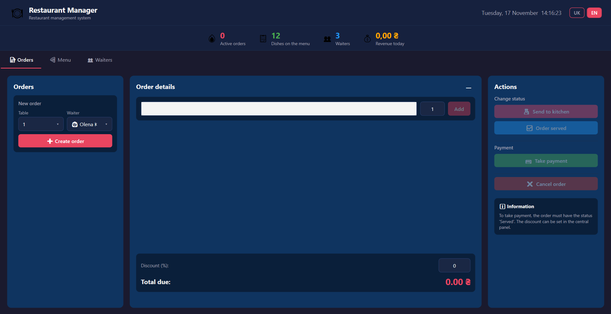
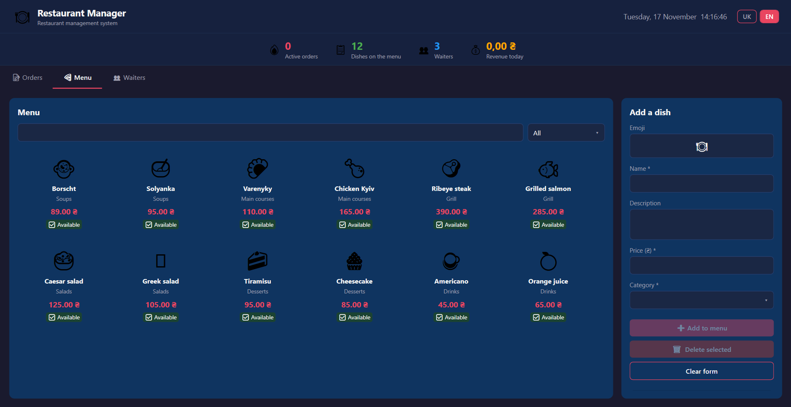
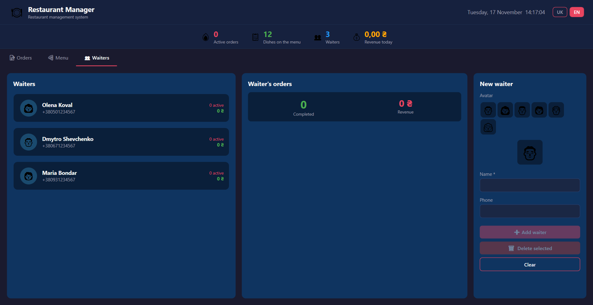
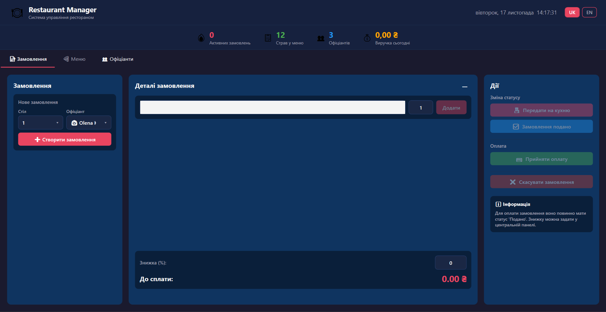

# Restaurant Manager

A desktop application for running a small restaurant: take orders at tables, manage the menu, and keep track of waiters and daily revenue. Built with **WPF**, **.NET 10** and the **MVVM** pattern. The interface is available in **Ukrainian and English** and can be switched while the app is running.



## Features

- **Orders**: create an order for a table and assign a waiter, add and remove dishes, set a discount (%), and move the order through its life cycle.
- **Order life cycle**: `Pending → In progress → Served → Paid`; an active order can be `Cancelled` at any time before payment. Payment is only possible once the order is served.
- **Menu**: search by name, filter by category, add new dishes (name, description, price, category, emoji), delete dishes.
- **Waiters**: list of waiters with the number of active orders and revenue, the orders of the selected waiter, add and remove waiters, avatar emoji.
- **Dashboard**: active orders, number of dishes, number of waiters and today's revenue, refreshed every 5 seconds, plus a live clock.
- **Two languages**: Ukrainian and English. Use the **UK / EN** buttons in the top-right corner. The whole interface, order statuses, messages, dates and the demo menu are translated immediately. The choice is remembered between launches.

## Tech stack

| | |
|---|---|
| Language / runtime | C# 13, .NET 10 |
| UI | WPF (XAML), custom control templates and styles |
| Architecture | MVVM, service layer, `INotifyPropertyChanged`, `ICommand` |
| Storage | In memory (demo data is created on every start) |

## Requirements

- Windows 10 or 11 (WPF runs on Windows only)
- [.NET 10 SDK](https://dotnet.microsoft.com/download) (or Visual Studio 2022/2026 with the **.NET desktop development** workload)

## Run

From the repository root:

```bash
dotnet run
```

or open the project in Visual Studio and press **F5**.

## Language switching

| | |
|---|---|
| Switch | UK / EN buttons in the header |
| Default | Ukrainian |
| Remembered in | `%AppData%\RestaurantApp\language.txt` (delete the file to reset) |
| Texts | `Localization/Strings.cs` (one dictionary per language) |

How it works:

- Texts in XAML use the `{loc:Tr Key}` markup extension. It is a binding to the `Loc` class, so every label updates the moment the language changes.
- Texts that depend on data (order numbers, statuses, availability) use `{loc:Fmt ...}`, `{loc:Status}` and `{loc:Avail}`.
- Texts built in code use `Loc.Get("Key", args)`.
- The demo dishes, categories and waiter names are translated in place (`RestaurantContext.ApplyLanguage`). Dishes you add yourself keep the text you typed.

To add a language, add a dictionary to `Strings.cs` with the same keys and extend `Loc.cs`.

## Project structure

```
RestaurantApp/
├── App.xaml / App.xaml.cs      # global styles and colors, startup (loads the saved language)
├── Localization/
│   ├── Loc.cs                  # current language, text lookup, saving the choice
│   ├── Strings.cs              # all texts (Ukrainian and English)
│   └── Extensions.cs           # {loc:Tr}, {loc:Fmt}, {loc:Status}, {loc:Avail}
├── Models/
│   ├── Dish.cs, Menu.cs        # menu items and the menu
│   ├── Order.cs, OrderItem.cs  # orders (implements IPayable)
│   ├── OrderStatus.cs          # status enum and display helpers
│   ├── Waiter.cs, Table.cs
│   ├── IPayable.cs             # interface for payable objects (polymorphism)
│   └── RestaurantContext.cs    # application state (singleton) and demo data
├── Services/
│   └── OrderService.cs         # order business logic, separate from the UI
├── ViewModels/                 # Main, Order, Menu and Waiter view models, RelayCommand
├── Views/                      # MainWindow and the Orders / Menu / Waiters pages
├── Converters/                 # value converters for XAML bindings
└── docs/screenshots/           # images for this README
```

## Demo data

On start the app creates 12 dishes in 6 categories, 3 waiters and 8 tables (4 tables for 2 guests, 4 tables for 4 guests). Nothing is saved to disk, so changes are lost when the app is closed.

## Screenshots

The first three screenshots show the English interface.

| Menu | Waiters |
|---|---|
|  |  |

Ukrainian interface (the **UK** button):



## Limitations

- Data is stored in memory only (no database).
- Windows only (WPF).
- The interface texts are translated; the text of any dish or waiter you create is shown exactly as you typed it.
